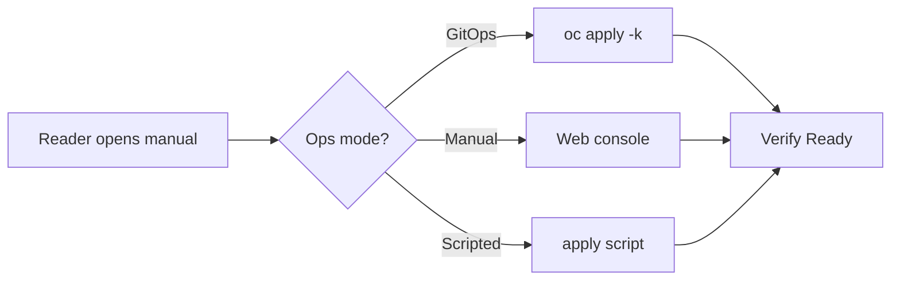

Everything here ships with oink 1.4.0. Nothing below needs new dependencies — most items are one config line or one shortcode. Each section illustrates itself where the page can render the real thing; where the feature needs a site-level toggle first (feedback, backlinks, palette commands), the page shows the config and what it would produce.

## Already shipped by the theme, not used here

Some capabilities the site already has through theme defaults — they show up the moment content asks for them:

- **Keyboard navigation** (`keyboard_nav: true`, theme default): WASD/arrow tree focus, `j`/`k` outline jumps, `q`/`e` paging, shell and palette toggles. The question-mark button in the footer's bottom bar (hover, focus, or touch — `?` itself is reserved and unbound) opens the cheat sheet listing every shortcut available on the current page.
- **Mermaid diagrams**: zero config — the runtime loads only on pages with a ```` ```mermaid ```` fence. First one on this page, below.
- **Right-rail taxonomy clouds** (`toc_taxonomies: true`, theme default): wired, but the manuals carry no tags. Adding `tags:` front matter to a manual is the whole activation.

## Config one-liners

### Per-page feedback

One-click 👍/👎 at the end of a page, recorded through the site's existing gtag integration. Two gates apply before any event is recorded: the GA4 ID must be real (it is in `hugo.yaml`, production only), and the widget itself is still disabled (`feedback.enable: false`). Enabling the snippet below lights up the widget on every page; enabling GA alone does not.

```yaml
params:
  ui:
    feedback:
      enable: true
```

What it renders (theme `feedback.html`, `enable: false` today — this is the theme's own markup):



### Backlinks

A right-rail group listing the pages that link here, derived from ordinary Markdown links at build time. No runtime. The manuals cross-link heavily (`operate.md` → `things-that-broke.md`), so every manual page gains an entry.

```yaml
params:
  ui:
    backlinks: true
```

The per-page override is separate: `backlinks: true` (or `false`) in a page's front matter turns the group on or off for that page, and a section can cascade it.

### Command-palette commands

`github_repo` and `github_branch` are set, and the theme already renders Edit/History/New-page links as page actions — but nothing declares palette commands, so ⌘K has no quick commands. Two rules from the theme (`actions/site-commands.html`): a command's `id` may not reuse a built-in action id (reserved ids warn and drop the row), and each command defines exactly one of `url` or `action`. Note `github_repo` must be the full `https://github.com/owner/repo` URL: the theme concatenates it raw into the action links, so a bare `owner/repo` value renders scheme-less links that browsers resolve against the current page (404).

```yaml
params:
  ui:
    command_palette:
      commands:
        - { id: edit-manual, title: Edit this page, action: edit_page }
        - { id: file-issue, title: File an issue, action: create_issue }
        - { id: copy-page, title: Copy page as Markdown, action: copy_markdown }
```

## Diagrams

### Mermaid — live on this page



### Markmap and PlantUML

Both off by default; 1.4.0 renders them in the browser with bundled scripts — no Java, Graphviz, npm, or CDN. Add `markmap: true` and `plantuml: {enable: true}`, then a ```` ```markmap ```` mind-map of the manual structure and PlantUML for the GitOps-vs-Manual flow.

## Authoring shortcodes the manuals don't use

| Shortcode | Use it for |
|---|---|
| `steps` | Procedure sections — styled step lists, degrades to a plain list in the Markdown output |
| `badge text=… tone=…` | Inline status labels: `prototype`, `3.6 only`, `broken in 3.4` |
| `fields` / `field` | Structured reference for the Hello World CR parameters |
| `tabs` / `tab` | Reader-visible parallel views (CLI vs console) — mode filtering stays with the variant selector |
| `include` | DRY the `oc login` snippet repeated across manuals — resource text is copied verbatim, so `customize` tokens inside an included file render literally (write plain example values there) |
| `contributors` | GitHub avatar wall from a `data/` file |

Each one, live:

1. Lead with the outcome — the first sentence says what changes.
2. State what must be true before starting.
3. Close with verification and rollback.
{.steps}



```sh
oc apply -k manifests/hello-world/
```







Replica count-driving size class.


Target RHAIE version.



Inline badges: this page is a ; the setup script is ; mid-flight rollback is .

The `include` demo — this very page, included as code with its leading fence visible:



### Landing sections

22 shipped, 3 used (`hero`, `cards`, `cta`). `timeline` matches the field-work chronology; `faq` for the questions behind the feedback CTA; `metrics` for compact numbers. All data-driven from `data/home.yaml`.

### Page bundles and galleries

Manuals are flat `.md` files. Leaf bundles let screenshots and manifests live beside the manual, then `image_zoom: true` gives native image preview and Expo geometry serves galleries.

## Provenance and polish

### Upstream attribution

`annotation: true` (theme default) renders a provenance block at the end of a page, but it has nothing to attribute. The MaaS-derived manuals should carry:

```yaml
upstream_link: https://github.com/rh-aiservices-bu/maas-guide
upstream_name: MaaS guide
upstream_copyright: Red Hat, Inc.
upstream_license: Apache-2.0
upstream_notice: https://github.com/rh-aiservices-bu/maas-guide#readme
```

`upstream_license` must be an SPDX identifier present in `data/licenses.yaml` (the theme ships CC-BY-4.0, MIT, Apache-2.0, and others; a site adds its own entries by merging its own `data/licenses.yaml`). The alternative route for a site citing many sources: name `upstream_source: maas-guide` and register `maas-guide` in a site-level `data/upstreams.yaml`, so each page carries one key instead of five.

### Section identity

`theme_color` / `theme_color_dark` in the existing `field-manual` cascade tints the section's accent grounds — selected sidebar row, hover washes, focus rings. The dark palette derives automatically when omitted.

### Custom context actions

`page_context_menu.links` accepts external actions with `{url}`, `{title}`, `{markdown_url}` placeholders — e.g. open the current page in an internal channel:

```yaml
params:
  ui:
    page_context_menu:
      links:
        - { name: Discuss in Matrix, url: "https://matrix.to/#/%23cai:example.org?url={url}" }
```
